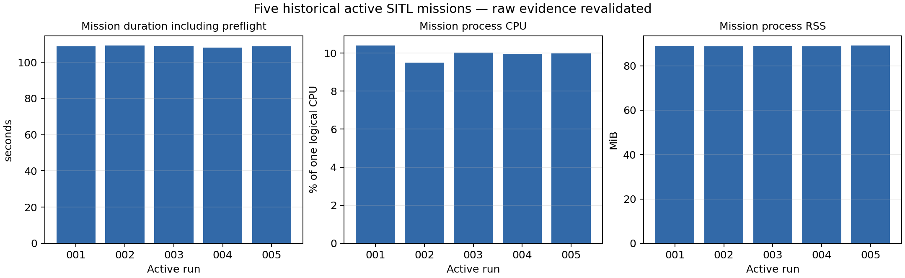
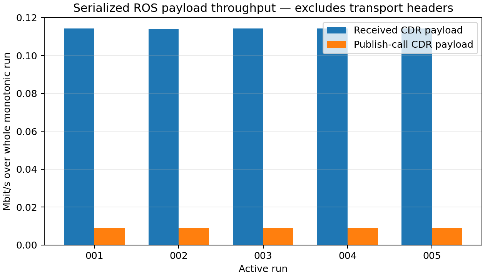

# Final Phase 1 metric verification

**The full objective remains incomplete.** Safe collection, offline verification and collector implementation are complete within the available permissions. Unmeasured/blocked metrics below are not promoted by test success.

The package passed **194 tests**, with **one existing copyright test skipped**, and built successfully. All **129 protected files** retained their original hashes. No mission, takeoff, arm, flight command, dependency installation, parameter write or DDS/firmware change was performed.

## Five active missions

| Run | Result | Duration (s) | Raw CSV |
|---|---|---:|---|
| phase1_active_run_001 | PASS | 108.716274157 | [baseline_run_001.csv](/home/kailash/ros2_ws/phase1_active_run_001/baseline_run_001.csv) |
| phase1_active_run_002 | PASS | 109.217756457 | [baseline_run_001.csv](/home/kailash/ros2_ws/phase1_active_run_002/baseline_run_001.csv) |
| phase1_active_run_003 | PASS | 109.141542454 | [baseline_run_001.csv](/home/kailash/ros2_ws/phase1_active_run_003/baseline_run_001.csv) |
| phase1_active_run_004 | PASS | 108.015096398 | [baseline_run_001.csv](/home/kailash/ros2_ws/phase1_active_run_004/baseline_run_001.csv) |
| phase1_active_run_005 | PASS | 108.814203864 | [baseline_run_001.csv](/home/kailash/ros2_ws/phase1_active_run_005/baseline_run_001.csv) |

Duration is logger initialization to completion, including preflight. Mean duration is **108.780975 s**; this is not airborne-only flight time. All five CSVs contain five accepted command ACKs and the ordered route/landing/disarm/completion events. Thirty historical passive captures remain separate and do not count as missions.

## Final requirements-to-evidence gate

| Metric | Status | Numerical result | Sample count | Evidence | Blocker / scope |
|---|---|---:|---:|---|---|
| mission_completion_s | VALIDATED | 108.780975 s | 5 | [baseline_run_001.csv](/home/kailash/ros2_ws/phase1_active_run_001/baseline_run_001.csv)<br>[baseline_run_001.csv](/home/kailash/ros2_ws/phase1_active_run_002/baseline_run_001.csv)<br>[baseline_run_001.csv](/home/kailash/ros2_ws/phase1_active_run_003/baseline_run_001.csv)<br>[baseline_run_001.csv](/home/kailash/ros2_ws/phase1_active_run_004/baseline_run_001.csv)<br>[baseline_run_001.csv](/home/kailash/ros2_ws/phase1_active_run_005/baseline_run_001.csv) | WSL simulation scope; historical configuration/version gaps remain; no independence CI |
| node_cpu_pct | VALIDATED | 9.96734273 % of one logical CPU | 5 | [baseline_run_001.csv](/home/kailash/ros2_ws/phase1_active_run_001/baseline_run_001.csv)<br>[baseline_run_001.csv](/home/kailash/ros2_ws/phase1_active_run_002/baseline_run_001.csv)<br>[baseline_run_001.csv](/home/kailash/ros2_ws/phase1_active_run_003/baseline_run_001.csv)<br>[baseline_run_001.csv](/home/kailash/ros2_ws/phase1_active_run_004/baseline_run_001.csv)<br>[baseline_run_001.csv](/home/kailash/ros2_ws/phase1_active_run_005/baseline_run_001.csv) | WSL simulation scope; historical configuration/version gaps remain; no independence CI |
| system_cpu_pct | VALIDATED | 28.949838 % WSL guest | 5 | [baseline_run_001.csv](/home/kailash/ros2_ws/phase1_active_run_001/baseline_run_001.csv)<br>[baseline_run_001.csv](/home/kailash/ros2_ws/phase1_active_run_002/baseline_run_001.csv)<br>[baseline_run_001.csv](/home/kailash/ros2_ws/phase1_active_run_003/baseline_run_001.csv)<br>[baseline_run_001.csv](/home/kailash/ros2_ws/phase1_active_run_004/baseline_run_001.csv)<br>[baseline_run_001.csv](/home/kailash/ros2_ws/phase1_active_run_005/baseline_run_001.csv) | WSL simulation scope; historical configuration/version gaps remain; no independence CI |
| node_rss_mib | VALIDATED | 88.8971859 MiB | 5 | [baseline_run_001.csv](/home/kailash/ros2_ws/phase1_active_run_001/baseline_run_001.csv)<br>[baseline_run_001.csv](/home/kailash/ros2_ws/phase1_active_run_002/baseline_run_001.csv)<br>[baseline_run_001.csv](/home/kailash/ros2_ws/phase1_active_run_003/baseline_run_001.csv)<br>[baseline_run_001.csv](/home/kailash/ros2_ws/phase1_active_run_004/baseline_run_001.csv)<br>[baseline_run_001.csv](/home/kailash/ros2_ws/phase1_active_run_005/baseline_run_001.csv) | WSL simulation scope; historical configuration/version gaps remain; no independence CI |
| rx_payload_mbps | VALIDATED | 0.114171015 Mbit/s | 5 | [baseline_run_001.csv](/home/kailash/ros2_ws/phase1_active_run_001/baseline_run_001.csv)<br>[baseline_run_001.csv](/home/kailash/ros2_ws/phase1_active_run_002/baseline_run_001.csv)<br>[baseline_run_001.csv](/home/kailash/ros2_ws/phase1_active_run_003/baseline_run_001.csv)<br>[baseline_run_001.csv](/home/kailash/ros2_ws/phase1_active_run_004/baseline_run_001.csv)<br>[baseline_run_001.csv](/home/kailash/ros2_ws/phase1_active_run_005/baseline_run_001.csv) | WSL simulation scope; historical configuration/version gaps remain; no independence CI |
| tx_payload_mbps | VALIDATED | 0.0091421248 Mbit/s | 5 | [baseline_run_001.csv](/home/kailash/ros2_ws/phase1_active_run_001/baseline_run_001.csv)<br>[baseline_run_001.csv](/home/kailash/ros2_ws/phase1_active_run_002/baseline_run_001.csv)<br>[baseline_run_001.csv](/home/kailash/ros2_ws/phase1_active_run_003/baseline_run_001.csv)<br>[baseline_run_001.csv](/home/kailash/ros2_ws/phase1_active_run_004/baseline_run_001.csv)<br>[baseline_run_001.csv](/home/kailash/ros2_ws/phase1_active_run_005/baseline_run_001.csv) | WSL simulation scope; historical configuration/version gaps remain; no independence CI |
| active_mission_success | VALIDATED | 5 successful missions | 5 | [baseline_run_001.csv](/home/kailash/ros2_ws/phase1_active_run_001/baseline_run_001.csv)<br>[baseline_run_001.csv](/home/kailash/ros2_ws/phase1_active_run_002/baseline_run_001.csv)<br>[baseline_run_001.csv](/home/kailash/ros2_ws/phase1_active_run_003/baseline_run_001.csv)<br>[baseline_run_001.csv](/home/kailash/ros2_ws/phase1_active_run_004/baseline_run_001.csv)<br>[baseline_run_001.csv](/home/kailash/ros2_ws/phase1_active_run_005/baseline_run_001.csv) | Five observed runs do not establish a general reliability probability |
| telemetry_rate:/fmu/out/battery_status_v1 | VALIDATED | 1.0001702 Hz | 5 | [baseline_run_001.csv](/home/kailash/ros2_ws/phase1_active_run_001/baseline_run_001.csv)<br>[baseline_run_001.csv](/home/kailash/ros2_ws/phase1_active_run_002/baseline_run_001.csv)<br>[baseline_run_001.csv](/home/kailash/ros2_ws/phase1_active_run_003/baseline_run_001.csv)<br>[baseline_run_001.csv](/home/kailash/ros2_ws/phase1_active_run_004/baseline_run_001.csv)<br>[baseline_run_001.csv](/home/kailash/ros2_ws/phase1_active_run_005/baseline_run_001.csv) | Received callback rates; no transmitted-message denominator |
| inter_arrival:/fmu/out/battery_status_v1 | VALIDATED | 1000.192 ms | 5 | [baseline_run_001.csv](/home/kailash/ros2_ws/phase1_active_run_001/baseline_run_001.csv)<br>[baseline_run_001.csv](/home/kailash/ros2_ws/phase1_active_run_002/baseline_run_001.csv)<br>[baseline_run_001.csv](/home/kailash/ros2_ws/phase1_active_run_003/baseline_run_001.csv)<br>[baseline_run_001.csv](/home/kailash/ros2_ws/phase1_active_run_004/baseline_run_001.csv)<br>[baseline_run_001.csv](/home/kailash/ros2_ws/phase1_active_run_005/baseline_run_001.csv) | Summary across run-level statistics, not source-to-receiver latency |
| jitter:/fmu/out/battery_status_v1 | VALIDATED | 1.99168049 ms | 5 | [baseline_run_001.csv](/home/kailash/ros2_ws/phase1_active_run_001/baseline_run_001.csv)<br>[baseline_run_001.csv](/home/kailash/ros2_ws/phase1_active_run_002/baseline_run_001.csv)<br>[baseline_run_001.csv](/home/kailash/ros2_ws/phase1_active_run_003/baseline_run_001.csv)<br>[baseline_run_001.csv](/home/kailash/ros2_ws/phase1_active_run_004/baseline_run_001.csv)<br>[baseline_run_001.csv](/home/kailash/ros2_ws/phase1_active_run_005/baseline_run_001.csv) | Summary across run-level statistics, not source-to-receiver latency |
| telemetry_rate:/fmu/out/estimator_status_flags | VALIDATED | 1.04798293 Hz | 5 | [baseline_run_001.csv](/home/kailash/ros2_ws/phase1_active_run_001/baseline_run_001.csv)<br>[baseline_run_001.csv](/home/kailash/ros2_ws/phase1_active_run_002/baseline_run_001.csv)<br>[baseline_run_001.csv](/home/kailash/ros2_ws/phase1_active_run_003/baseline_run_001.csv)<br>[baseline_run_001.csv](/home/kailash/ros2_ws/phase1_active_run_004/baseline_run_001.csv)<br>[baseline_run_001.csv](/home/kailash/ros2_ws/phase1_active_run_005/baseline_run_001.csv) | Received callback rates; no transmitted-message denominator |
| inter_arrival:/fmu/out/estimator_status_flags | VALIDATED | 954.468367 ms | 5 | [baseline_run_001.csv](/home/kailash/ros2_ws/phase1_active_run_001/baseline_run_001.csv)<br>[baseline_run_001.csv](/home/kailash/ros2_ws/phase1_active_run_002/baseline_run_001.csv)<br>[baseline_run_001.csv](/home/kailash/ros2_ws/phase1_active_run_003/baseline_run_001.csv)<br>[baseline_run_001.csv](/home/kailash/ros2_ws/phase1_active_run_004/baseline_run_001.csv)<br>[baseline_run_001.csv](/home/kailash/ros2_ws/phase1_active_run_005/baseline_run_001.csv) | Summary across run-level statistics, not source-to-receiver latency |
| jitter:/fmu/out/estimator_status_flags | VALIDATED | 192.982473 ms | 5 | [baseline_run_001.csv](/home/kailash/ros2_ws/phase1_active_run_001/baseline_run_001.csv)<br>[baseline_run_001.csv](/home/kailash/ros2_ws/phase1_active_run_002/baseline_run_001.csv)<br>[baseline_run_001.csv](/home/kailash/ros2_ws/phase1_active_run_003/baseline_run_001.csv)<br>[baseline_run_001.csv](/home/kailash/ros2_ws/phase1_active_run_004/baseline_run_001.csv)<br>[baseline_run_001.csv](/home/kailash/ros2_ws/phase1_active_run_005/baseline_run_001.csv) | Summary across run-level statistics, not source-to-receiver latency |
| telemetry_rate:/fmu/out/vehicle_attitude | VALIDATED | 49.9445231 Hz | 5 | [baseline_run_001.csv](/home/kailash/ros2_ws/phase1_active_run_001/baseline_run_001.csv)<br>[baseline_run_001.csv](/home/kailash/ros2_ws/phase1_active_run_002/baseline_run_001.csv)<br>[baseline_run_001.csv](/home/kailash/ros2_ws/phase1_active_run_003/baseline_run_001.csv)<br>[baseline_run_001.csv](/home/kailash/ros2_ws/phase1_active_run_004/baseline_run_001.csv)<br>[baseline_run_001.csv](/home/kailash/ros2_ws/phase1_active_run_005/baseline_run_001.csv) | Received callback rates; no transmitted-message denominator |
| inter_arrival:/fmu/out/vehicle_attitude | VALIDATED | 20.0023986 ms | 5 | [baseline_run_001.csv](/home/kailash/ros2_ws/phase1_active_run_001/baseline_run_001.csv)<br>[baseline_run_001.csv](/home/kailash/ros2_ws/phase1_active_run_002/baseline_run_001.csv)<br>[baseline_run_001.csv](/home/kailash/ros2_ws/phase1_active_run_003/baseline_run_001.csv)<br>[baseline_run_001.csv](/home/kailash/ros2_ws/phase1_active_run_004/baseline_run_001.csv)<br>[baseline_run_001.csv](/home/kailash/ros2_ws/phase1_active_run_005/baseline_run_001.csv) | Summary across run-level statistics, not source-to-receiver latency |
| jitter:/fmu/out/vehicle_attitude | VALIDATED | 1.18310548 ms | 5 | [baseline_run_001.csv](/home/kailash/ros2_ws/phase1_active_run_001/baseline_run_001.csv)<br>[baseline_run_001.csv](/home/kailash/ros2_ws/phase1_active_run_002/baseline_run_001.csv)<br>[baseline_run_001.csv](/home/kailash/ros2_ws/phase1_active_run_003/baseline_run_001.csv)<br>[baseline_run_001.csv](/home/kailash/ros2_ws/phase1_active_run_004/baseline_run_001.csv)<br>[baseline_run_001.csv](/home/kailash/ros2_ws/phase1_active_run_005/baseline_run_001.csv) | Summary across run-level statistics, not source-to-receiver latency |
| telemetry_rate:/fmu/out/vehicle_command_ack_v1 | VALIDATED | 0.0459646311 Hz | 5 | [baseline_run_001.csv](/home/kailash/ros2_ws/phase1_active_run_001/baseline_run_001.csv)<br>[baseline_run_001.csv](/home/kailash/ros2_ws/phase1_active_run_002/baseline_run_001.csv)<br>[baseline_run_001.csv](/home/kailash/ros2_ws/phase1_active_run_003/baseline_run_001.csv)<br>[baseline_run_001.csv](/home/kailash/ros2_ws/phase1_active_run_004/baseline_run_001.csv)<br>[baseline_run_001.csv](/home/kailash/ros2_ws/phase1_active_run_005/baseline_run_001.csv) | Received callback rates; no transmitted-message denominator |
| inter_arrival:/fmu/out/vehicle_command_ack_v1 | VALIDATED | 26447.9604 ms | 5 | [baseline_run_001.csv](/home/kailash/ros2_ws/phase1_active_run_001/baseline_run_001.csv)<br>[baseline_run_001.csv](/home/kailash/ros2_ws/phase1_active_run_002/baseline_run_001.csv)<br>[baseline_run_001.csv](/home/kailash/ros2_ws/phase1_active_run_003/baseline_run_001.csv)<br>[baseline_run_001.csv](/home/kailash/ros2_ws/phase1_active_run_004/baseline_run_001.csv)<br>[baseline_run_001.csv](/home/kailash/ros2_ws/phase1_active_run_005/baseline_run_001.csv) | Summary across run-level statistics, not source-to-receiver latency |
| jitter:/fmu/out/vehicle_command_ack_v1 | VALIDATED | 29406.1684 ms | 5 | [baseline_run_001.csv](/home/kailash/ros2_ws/phase1_active_run_001/baseline_run_001.csv)<br>[baseline_run_001.csv](/home/kailash/ros2_ws/phase1_active_run_002/baseline_run_001.csv)<br>[baseline_run_001.csv](/home/kailash/ros2_ws/phase1_active_run_003/baseline_run_001.csv)<br>[baseline_run_001.csv](/home/kailash/ros2_ws/phase1_active_run_004/baseline_run_001.csv)<br>[baseline_run_001.csv](/home/kailash/ros2_ws/phase1_active_run_005/baseline_run_001.csv) | Summary across run-level statistics, not source-to-receiver latency |
| telemetry_rate:/fmu/out/vehicle_land_detected | VALIDATED | 1.06083826 Hz | 5 | [baseline_run_001.csv](/home/kailash/ros2_ws/phase1_active_run_001/baseline_run_001.csv)<br>[baseline_run_001.csv](/home/kailash/ros2_ws/phase1_active_run_002/baseline_run_001.csv)<br>[baseline_run_001.csv](/home/kailash/ros2_ws/phase1_active_run_003/baseline_run_001.csv)<br>[baseline_run_001.csv](/home/kailash/ros2_ws/phase1_active_run_004/baseline_run_001.csv)<br>[baseline_run_001.csv](/home/kailash/ros2_ws/phase1_active_run_005/baseline_run_001.csv) | Received callback rates; no transmitted-message denominator |
| inter_arrival:/fmu/out/vehicle_land_detected | VALIDATED | 944.828979 ms | 5 | [baseline_run_001.csv](/home/kailash/ros2_ws/phase1_active_run_001/baseline_run_001.csv)<br>[baseline_run_001.csv](/home/kailash/ros2_ws/phase1_active_run_002/baseline_run_001.csv)<br>[baseline_run_001.csv](/home/kailash/ros2_ws/phase1_active_run_003/baseline_run_001.csv)<br>[baseline_run_001.csv](/home/kailash/ros2_ws/phase1_active_run_004/baseline_run_001.csv)<br>[baseline_run_001.csv](/home/kailash/ros2_ws/phase1_active_run_005/baseline_run_001.csv) | Summary across run-level statistics, not source-to-receiver latency |
| jitter:/fmu/out/vehicle_land_detected | VALIDATED | 203.314101 ms | 5 | [baseline_run_001.csv](/home/kailash/ros2_ws/phase1_active_run_001/baseline_run_001.csv)<br>[baseline_run_001.csv](/home/kailash/ros2_ws/phase1_active_run_002/baseline_run_001.csv)<br>[baseline_run_001.csv](/home/kailash/ros2_ws/phase1_active_run_003/baseline_run_001.csv)<br>[baseline_run_001.csv](/home/kailash/ros2_ws/phase1_active_run_004/baseline_run_001.csv)<br>[baseline_run_001.csv](/home/kailash/ros2_ws/phase1_active_run_005/baseline_run_001.csv) | Summary across run-level statistics, not source-to-receiver latency |
| telemetry_rate:/fmu/out/vehicle_local_position_v1 | VALIDATED | 49.9445231 Hz | 5 | [baseline_run_001.csv](/home/kailash/ros2_ws/phase1_active_run_001/baseline_run_001.csv)<br>[baseline_run_001.csv](/home/kailash/ros2_ws/phase1_active_run_002/baseline_run_001.csv)<br>[baseline_run_001.csv](/home/kailash/ros2_ws/phase1_active_run_003/baseline_run_001.csv)<br>[baseline_run_001.csv](/home/kailash/ros2_ws/phase1_active_run_004/baseline_run_001.csv)<br>[baseline_run_001.csv](/home/kailash/ros2_ws/phase1_active_run_005/baseline_run_001.csv) | Received callback rates; no transmitted-message denominator |
| inter_arrival:/fmu/out/vehicle_local_position_v1 | VALIDATED | 20.0024145 ms | 5 | [baseline_run_001.csv](/home/kailash/ros2_ws/phase1_active_run_001/baseline_run_001.csv)<br>[baseline_run_001.csv](/home/kailash/ros2_ws/phase1_active_run_002/baseline_run_001.csv)<br>[baseline_run_001.csv](/home/kailash/ros2_ws/phase1_active_run_003/baseline_run_001.csv)<br>[baseline_run_001.csv](/home/kailash/ros2_ws/phase1_active_run_004/baseline_run_001.csv)<br>[baseline_run_001.csv](/home/kailash/ros2_ws/phase1_active_run_005/baseline_run_001.csv) | Summary across run-level statistics, not source-to-receiver latency |
| jitter:/fmu/out/vehicle_local_position_v1 | VALIDATED | 1.15502569 ms | 5 | [baseline_run_001.csv](/home/kailash/ros2_ws/phase1_active_run_001/baseline_run_001.csv)<br>[baseline_run_001.csv](/home/kailash/ros2_ws/phase1_active_run_002/baseline_run_001.csv)<br>[baseline_run_001.csv](/home/kailash/ros2_ws/phase1_active_run_003/baseline_run_001.csv)<br>[baseline_run_001.csv](/home/kailash/ros2_ws/phase1_active_run_004/baseline_run_001.csv)<br>[baseline_run_001.csv](/home/kailash/ros2_ws/phase1_active_run_005/baseline_run_001.csv) | Summary across run-level statistics, not source-to-receiver latency |
| telemetry_rate:/fmu/out/vehicle_status_v4 | VALIDATED | 2.08309584 Hz | 5 | [baseline_run_001.csv](/home/kailash/ros2_ws/phase1_active_run_001/baseline_run_001.csv)<br>[baseline_run_001.csv](/home/kailash/ros2_ws/phase1_active_run_002/baseline_run_001.csv)<br>[baseline_run_001.csv](/home/kailash/ros2_ws/phase1_active_run_003/baseline_run_001.csv)<br>[baseline_run_001.csv](/home/kailash/ros2_ws/phase1_active_run_004/baseline_run_001.csv)<br>[baseline_run_001.csv](/home/kailash/ros2_ws/phase1_active_run_005/baseline_run_001.csv) | Received callback rates; no transmitted-message denominator |
| inter_arrival:/fmu/out/vehicle_status_v4 | VALIDATED | 480.767099 ms | 5 | [baseline_run_001.csv](/home/kailash/ros2_ws/phase1_active_run_001/baseline_run_001.csv)<br>[baseline_run_001.csv](/home/kailash/ros2_ws/phase1_active_run_002/baseline_run_001.csv)<br>[baseline_run_001.csv](/home/kailash/ros2_ws/phase1_active_run_003/baseline_run_001.csv)<br>[baseline_run_001.csv](/home/kailash/ros2_ws/phase1_active_run_004/baseline_run_001.csv)<br>[baseline_run_001.csv](/home/kailash/ros2_ws/phase1_active_run_005/baseline_run_001.csv) | Summary across run-level statistics, not source-to-receiver latency |
| jitter:/fmu/out/vehicle_status_v4 | VALIDATED | 91.0418212 ms | 5 | [baseline_run_001.csv](/home/kailash/ros2_ws/phase1_active_run_001/baseline_run_001.csv)<br>[baseline_run_001.csv](/home/kailash/ros2_ws/phase1_active_run_002/baseline_run_001.csv)<br>[baseline_run_001.csv](/home/kailash/ros2_ws/phase1_active_run_003/baseline_run_001.csv)<br>[baseline_run_001.csv](/home/kailash/ros2_ws/phase1_active_run_004/baseline_run_001.csv)<br>[baseline_run_001.csv](/home/kailash/ros2_ws/phase1_active_run_005/baseline_run_001.csv) | Summary across run-level statistics, not source-to-receiver latency |
| command_latency | NOT_MEASURED | N/A | 0 | [baseline_run_001.csv](/home/kailash/ros2_ws/phase1_active_run_001/baseline_run_001.csv)<br>[baseline_run_001.csv](/home/kailash/ros2_ws/phase1_active_run_002/baseline_run_001.csv)<br>[baseline_run_001.csv](/home/kailash/ros2_ws/phase1_active_run_003/baseline_run_001.csv)<br>[baseline_run_001.csv](/home/kailash/ros2_ws/phase1_active_run_004/baseline_run_001.csv)<br>[baseline_run_001.csv](/home/kailash/ros2_ws/phase1_active_run_005/baseline_run_001.csv) | No unique request ID/source identity; future authorized instrumented run needed for candidates and PX4-side evidence for confirmed association |
| command_candidate_interval | NOT_MEASURED | N/A | 0 | [baseline_run_001.csv](/home/kailash/ros2_ws/phase1_active_run_001/baseline_run_001.csv)<br>[baseline_run_001.csv](/home/kailash/ros2_ws/phase1_active_run_002/baseline_run_001.csv)<br>[baseline_run_001.csv](/home/kailash/ros2_ws/phase1_active_run_003/baseline_run_001.csv)<br>[baseline_run_001.csv](/home/kailash/ros2_ws/phase1_active_run_004/baseline_run_001.csv)<br>[baseline_run_001.csv](/home/kailash/ros2_ws/phase1_active_run_005/baseline_run_001.csv) | Historical runs predate publication monotonic_ns evidence; do not reconstruct from delayed logger events |
| telemetry_latency | NOT_MEASURED | N/A | 0 | [clock_probe_d90e76bbde7e4295904e87b70b188454.csv](/home/kailash/ros2_ws/phase1_missing_metrics_20261013_032039_UTC/clock/clock_probe_d90e76bbde7e4295904e87b70b188454.csv) | Native-to-host clock scale/offset validity interval and independent uncertainty validation absent; simultaneous native ULog/calibration needed |
| end_to_end_latency | NOT_MEASURED | N/A | 0 | No metric-specific raw evidence | Remote application endpoint with unique echoed request ID and common-clock evidence required; localhost bench is not UAV E2E |
| application_sequence_loss | NOT_MEASURED | N/A | 0 | No metric-specific raw evidence | PX4 path lacks observed sender and receiver sequence IDs and closed drain window |
| wire_packet_loss | NOT_MEASURED | N/A | 0 | No metric-specific raw evidence | Wire sender/receiver identities and capture/drop accounting at both endpoints required; a single capture is not a loss denominator |
| trajectory_rmse | NOT_MEASURED | N/A | 0 | [observations.jsonl](/home/kailash/ros2_ws/phase1_missing_metrics_20261013_032039_UTC/passive/observations.jsonl)<br>[native_log_audit.json](/home/kailash/ros2_ws/phase1_missing_metrics_20261013_032039_UTC/native/native_log_audit.json) | Native estimator and Gazebo-derived truth logs exist, but pose event-time uncertainty and frame/origin mapping are not independently verified; further controlled flight requires permission |
| physical_power | UNAVAILABLE_IN_CURRENT_SETUP | N/A | 0 | No metric-specific raw evidence | Calibrated physical UAV voltage/current instrument required |
| physical_energy | UNAVAILABLE_IN_CURRENT_SETUP | N/A | 0 | No metric-specific raw evidence | Physical hardware and calibrated synchronized power window required |
| simulated_power | UNAVAILABLE_IN_CURRENT_SETUP | N/A | 0 | [observations.jsonl](/home/kailash/ros2_ws/phase1_missing_metrics_20261013_032039_UTC/passive/observations.jsonl)<br>[native_log_audit.json](/home/kailash/ros2_ws/phase1_missing_metrics_20261013_032039_UTC/native/native_log_audit.json) | Battery simulator uses current_a=-1; no credible current/power model |
| simulated_energy | UNAVAILABLE_IN_CURRENT_SETUP | N/A | 0 | [observations.jsonl](/home/kailash/ros2_ws/phase1_missing_metrics_20261013_032039_UTC/passive/observations.jsonl)<br>[native_log_audit.json](/home/kailash/ros2_ws/phase1_missing_metrics_20261013_032039_UTC/native/native_log_audit.json) | Invalid current must not be replaced with zero; model or sensor needed |
| physical_link_capacity | UNAVAILABLE_IN_CURRENT_SETUP | N/A | 0 | No metric-specific raw evidence | WSL loopback offered traffic cannot measure radio link capacity |
| wire_throughput_current | NOT_MEASURED | N/A | 0 | [capture.json](/home/kailash/ros2_ws/phase1_missing_metrics_20261013_032039_UTC/wire/capture.json) | tcpdump capture permission denied; dumpcap execution denied; sudo requires a password |
| historical_run_provenance | MEASURED_UNVALIDATED | N/A | 5 | [provenance_recovery.json](/home/kailash/ros2_ws/phase1_missing_metrics_20261013_032039_UTC/provenance_recovery.json)<br>[native_log_audit.json](/home/kailash/ros2_ws/phase1_missing_metrics_20261013_032039_UTC/native/native_log_audit.json) | Historical config file/hash and versions are missing in mission CSV metadata; ULog overlap is not independently proven unique association |
| wire_throughput_historical | MEASURED_UNVALIDATED | 580213.544 bit/s | 11290 | [xrce_baseline.pcap](/home/kailash/ros2_ws/baseline_results/pcap/xrce_baseline.pcap)<br>[historical_packets.csv](/home/kailash/ros2_ws/phase1_missing_metrics_20261013_032039_UTC/final_report/historical_packets.csv) | Both directions, WSL loopback; excludes physical radio. Historical capture window, interface, filter and drops are not recorded |

Mean, sample standard deviation, median, nearest-rank p95 and observation windows are retained in [metric_summary.csv](final_report/metric_summary.csv) and [results.json](final_report/results.json). For the historical metrics, the summary statistical unit is each run’s mean/rate; per-run callback/resource distributions and underlying sample counts appear in active_runs.json. No independence-based confidence interval is claimed.

## Actual new observations

The subscription-only collector recorded 742 Gazebo poses, 716 PX4 positions and 14 battery samples. Airborne estimates: **0**. No grounded-only RMSE was calculated. All recorded currents were -1 A (invalid sentinel), so power and energy are N/A, not zero.

Five closed native ULogs were exported and hashed. They contain estimator and Gazebo-derived ground-truth position streams, recorded firmware hash **43cccdea0e57cf92a58562d2d7a1cba0854395f7**, reset counters, timesync and battery data. All their battery current values were -1 A. Their UTC filename overlap is only a candidate association with the mission CSVs. Groundtruth is timestamped at native callback reception; Gazebo pose acquisition age was not logged. Independent frame/origin and source-event time validation is still required before accepting flight RMSE.

The prior PCAP contains **11,290 packets**, **1,884,248 original/captured bytes**, with two parsers agreeing. UDP endpoint decoding found **11,239 PX4-to-agent packets** and **51 agent-to-PX4 packets**. Its first-to-last packet span is about **25.980062 s**, giving a conditional estimate of **580,213.54 bit/s**. This remains MEASURED_UNVALIDATED because the true capture window/interface/filter/drop counters were not recorded. This estimate is not radio capacity or a loss measurement.

A new bounded wire capture was attempted. tcpdump lacked device access, dumpcap execution was denied, and sudo -n required a password. No capture privileges were changed. Details: wire/capture.json, wire/tcpdump.log, dumpcap.log and privileged_capture.log.

The isolated localhost probe delivered 20/20 unique application IDs, with 0 duplicates and 0 missing IDs. Mean echo RTT: 201.750 us. These real observations validate collector mechanics only and never substitute for PX4 path latency/loss.

## Provenance and discrepancy review

Original controller bytes recovered from Git HEAD match the recorded mission_node.py SHA-256 in all five CSVs. provenance_recovery.json preserves exact retained matches. Missing historical experiment IDs, configuration paths/hashes and recorded environment versions remain unknown. Current configuration was hashed only for new passive collection. ULog version evidence was retained in a sidecar, not copied into historical mission metadata.

The existing phase1_five_run_summary.csv agrees exactly with raw durations, ACK counts/results and row counts. The older phase1_audit_20261012 report says zero active attempts because its inventory did not cover the five active-run directories. This report corrects the inventory without rewriting the old report.

## Exact remaining measurement procedures

1. **Fresh wire throughput:** an operator with existing packet-capture privileges can run the bounded collector below on loopback UDP 8888. Preserve capture.json, traffic.pcap and tcpdump.log; independently recompute packet/frame/IP/UDP totals and verify drop counters. This is passive collection and requires capture access, not a mission.

```bash
source /opt/ros/jazzy/setup.bash
source /home/kailash/ros2_ws/install/setup.bash
cd /home/kailash/ros2_ws/src/baseline_measurement
PYTHONDONTWRITEBYTECODE=1 PYTHONPATH="$PWD:$PYTHONPATH" python3 -m baseline_measurement.wire_capture --interface lo --port 8888 --seconds 15 --output /tmp/new_xrce_capture
```

2. **Command candidates:** use the updated, reviewed controller in a separately authorized sequential mission, preserving command_publication and command_ack details. Repeats/overlap/parameter variants remain ambiguous. ACKs lack source identity and unique request IDs; uniquely validated latency additionally requires independently evidenced PX4-side correlation. No authorization to fly was inferred here.

3. **Telemetry/E2E latency:** define the native source event and callback endpoint; simultaneously capture native ULog, received DDS fields, timesync/session offset and an independent clock reference. Validate scale, offset, validity interval and uncertainty. For remote E2E, add a unique request/response identity at the chosen application endpoint. Do not substitute RTT or callback intervals.

4. **Flight RMSE:** first review the retained native logs and recorded origins. If the missing source-event timing/frame evidence cannot be recovered, obtain explicit permission for a controlled flight while running passive_metrics and native logging simultaneously. Preserve Gazebo pose source stamp, PX4 native/delivered/sample stamps, common-frame/origin evidence, armed/landed state and reset counters. Supply independently reviewed calibration and frame metadata to trajectory_rmse. No unexplained reset boundary or grounded-only sample is accepted.

5. **PX4 application/wire loss:** add or expose genuine sender/receiver sequence identities at the actual PX4 path, close the observation/drain window, account for duplicates and capture drops at both endpoints. Any firmware/environment change requires a separate reviewed plan and approval. Single-sided captures and expected callback frequencies cannot provide the denominator.

6. **Power/energy and radio capacity:** calibrated physical UAV voltage/current instrumentation and a physical link are required for those scopes. A separately approved credible simulation power model may produce simulated estimates, never physical electrical measurements.

## Reproduction and preservation

Run baseline_measurement.metrics_audit against ros2_ws into a new output directory to reproduce raw mission and historical-PCAP results. Put passive/, native/ and wire/ evidence beside that output directory to include the new collectors. Native exports can be reproduced with native_log_audit using the exact paths in native/native_log_audit.json. plot_results.py reproduces the PNG figures. Exact commands, test cases and build output are retained in validation.json, test_results.txt and the build logs.

Safety AST checks verified unchanged command construction, rejection predicate/fail call, callback safety guards, telemetry predicates, timer loop and actual publisher call. Built package source bytes match the final maintained sources. Historical raw logs, plans, reports and configuration hashes were checked before/after.




